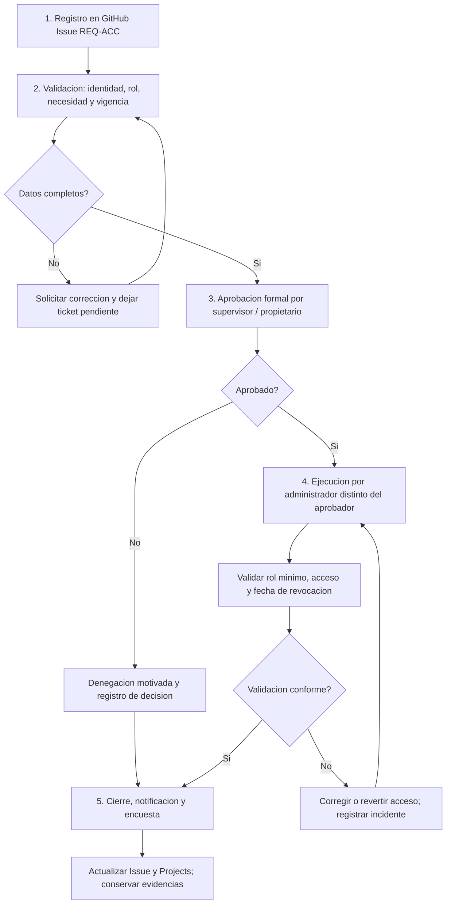

# APF3 | Gestión de solicitudes de servicio y accesos

**Sistema:** Delicias Peruanas · **Marco de referencia:** ITIL 4 e ISO/IEC 20000-1 · **Fecha:** 03/11/2026  
**Canal de registro:** GitHub Issues del repositorio; seguimiento visual en [GitHub Projects APF3](https://github.com/users/rabv7399/projects/5/views/1).  
**Alcance:** procedimiento propuesto y tickets de demostración registrados. **No** se afirma que se hayan concedido accesos, resuelto tickets o medido cumplimiento de SLA.

## 1. Catálogo de solicitudes (entregable 1)

| Código y ticket | Tipo | Solicitante y campos obligatorios | Canal / entregable |
|---|---|---|---|
| [REQ-INFO-01 (#36)](https://github.com/rabv7399/Integrador2-grupoRonald/issues/36) | Información: consulta sobre reservas | Nombre, contacto, asunto, fecha/hora de consulta, descripción | Issue; respuesta documentada sobre procedimiento de reservas y cierre confirmado |
| [REQ-ACC-01 (#38)](https://github.com/rabv7399/Integrador2-grupoRonald/issues/38) | Acceso: alta de cuenta OPERADOR | Identificación del solicitante, correo corporativo, motivo, supervisor, alcance y vigencia | Issue; cuenta habilitada **solo tras aprobación** y confirmación al solicitante |
| [REQ-ACC-02 (#37)](https://github.com/rabv7399/Integrador2-grupoRonald/issues/37) | Provisión de recursos/privilegios: permisos ADMIN | Identificación, rol actual, necesidad justificada, alcance, duración, responsable de negocio | Issue; ajuste de permisos o denegación motivada con evidencia de auditoría |

Las solicitudes de acceso se relacionan con los roles `ADMIN`, `OPERADOR` y `CLIENTE` definidos en `SecurityConfig.java`; por ejemplo, la gestión de mesas exige `ADMIN` u `OPERADOR`, y las altas de categorías exigen `ADMIN`. Ningún ticket concede permisos por sí mismo.

## 2. Matriz de gobernanza y segregación de funciones (entregable 2)

| Servicio | Aprobación formal | Aprobador de negocio propuesto | Ejecutor técnico propuesto | Auditoría |
|---|---|---|---|---|
| REQ-INFO-01 | No, salvo consulta sensible | Responsable de atención/soporte | Soporte | Historial de Issue, comentario de respuesta y confirmación |
| REQ-ACC-01 | **Sí** | Supervisor de operaciones del restaurante | Administrador de usuarios distinto del aprobador | Ticket, autorización, registro de alta, rol mínimo, fecha y revocación |
| REQ-ACC-02 | **Sí, reforzada** | Propietario del servicio / responsable del negocio | Administrador de seguridad distinto del aprobador | Ticket, justificación, aprobación, evidencia del cambio, caducidad y revisión |

**Control SoD:** quien solicita no se autoaprueba; quien aprueba no debería ejecutar el cambio privilegiado. Si el equipo real es unipersonal, se documenta la excepción y se solicita validación del docente o responsable del negocio antes de conceder privilegios. **Estado real:** la segregación está diseñada, pero no se han aportado aprobaciones ni ejecuciones de alta reales. El historial de GitHub es trazable, aunque no debe calificarse como registro técnicamente inmutable.

## 3. SLA propuestos e impacto por incumplimiento (entregable 3)

Horario de cómputo **propuesto:** lunes a viernes, 09:00–18:00, excluyendo feriados. El reloj se inicia cuando la solicitud está completa; se documentan las pausas justificadas por falta de información/aprobación.

| Servicio | Prioridad | Primera respuesta (TTR) | Resolución objetivo | Impacto o penalidad referencial |
|---|---|---:|---:|---|
| REQ-INFO-01 | Baja | 4 h laborables | 8 h laborables | S/ 10 por incumplimiento injustificado (valor de ejercicio) |
| REQ-ACC-01 | Media | 2 h laborables | 16 h laborables | S/ 25 por incumplimiento injustificado (valor de ejercicio) |
| REQ-ACC-02 | Alta | 1 h laborable | 8 h laborables | S/ 50 por incumplimiento injustificado (valor de ejercicio) |

**Precisión:** estos montos son **estimaciones académicas**, no multas contractuales vigentes ni costos reales registrados. La penalidad requeriría un SLA formal firmado. No hay datos suficientes para calcular tasas reales de cumplimiento.

**Indicadores futuros:** `TTR = primera respuesta - registro válido`; `TTRsol = cierre - registro válido - pausas justificadas`; `cumplimiento = tickets dentro del plazo / tickets cerrados con datos completos × 100`. Medir por prioridad y por período; no confundir un comentario de seguimiento con la resolución.

## 4. Ciclo de vida de una solicitud de acceso (entregable 4)

1. **Registro.** Solicitante abre GitHub Issue REQ-ACC-01/02, declara necesidad y plazo; se asigna identificador y responsable de seguimiento.
2. **Validación.** Soporte comprueba identidad, datos mínimos, rol requerido, justificación y ausencia de duplicados. Solicita información faltante sin otorgar permisos.
3. **Aprobación.** Supervisor/propietario del servicio aprueba o rechaza por escrito; para `ADMIN` se requiere justificación reforzada y plazo de vigencia. Sin aprobación, el ticket permanece pendiente.
4. **Ejecución.** Personal autorizado configura la cuenta o el rol mínimo necesario; comprueba acceso y ausencia de privilegios excesivos. No se publican contraseñas ni tokens en GitHub.
5. **Cierre y encuesta.** Se registra resultado, fecha, evidencia sin datos sensibles y conformidad del solicitante; se actualiza a `Done`/cerrado únicamente cuando se haya verificado. Se invita a calificar la atención y se programa revisión/revocación del acceso.

**Flujo operativo:** `Todo → In Progress → Done`, con rechazo o espera de aprobación registrados mediante comentarios/etiquetas. Las Issues #36–#38 se crearon y clasificaron; su estado pendiente no equivale a atención finalizada.

### Diagrama operativo con decisiones de control

El siguiente flujo es un **procedimiento diseñado**, no evidencia de altas de usuarios ya ejecutadas. Cada solicitud debe dejar registro de su responsable, fecha, aprobación y resultado.

### Auditoria y conservacion de evidencias

- **Rastro disponible hoy:** ID de Issue, comentarios fechados, PR, checks y commits. Proporcionan trazabilidad, **pero no inmutabilidad garantizada**.
- **Control propuesto para alcanzar mayor rigor:** exportar periodicamente tickets y decisiones a almacenamiento de solo adicion o retencion protegida, con hash SHA-256 y acceso restringido al responsable de auditoria; guardar comprobante de exportacion y periodo de retencion.
- **SoD:** aprobador y ejecutor deben ser personas distintas; cuando el equipo no pueda cumplirlo, documentar la excepcion y obtener validacion externa antes de ejecutar.
- **Estado de implantacion:** exportacion inmutable y controles de retencion **no implementados ni comprobados**. No se atribuyen evidencias inexistentes.

## 5. Evidencias verificables

- **Figura 05:** clasificación y responsable del ticket REQ-INFO-01.
- **Figura 06:** tablero de GitHub Projects con tres solicitudes en `Todo`.
- **Figura 07:** prioridad alta y trazabilidad de REQ-ACC-02.
- **Figura 08:** comentario de seguimiento inicial en REQ-INFO-01.
- [Issue #36](https://github.com/rabv7399/Integrador2-grupoRonald/issues/36), [Issue #37](https://github.com/rabv7399/Integrador2-grupoRonald/issues/37) e [Issue #38](https://github.com/rabv7399/Integrador2-grupoRonald/issues/38).

**Mejora priorizada:** agregar plantillas de Issues, registrar aprobaciones diferenciadas, formalizar el horario de soporte y medir SLA a partir de tickets cerrados reales.
