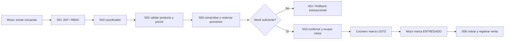
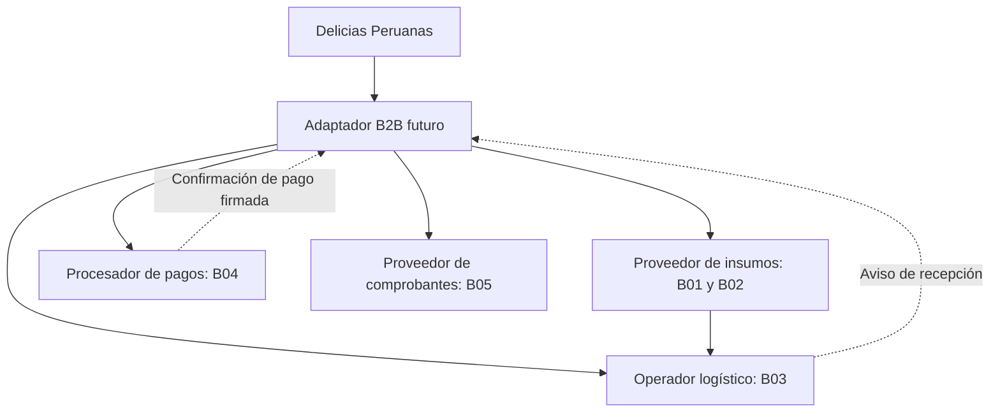
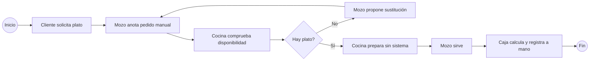
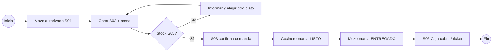
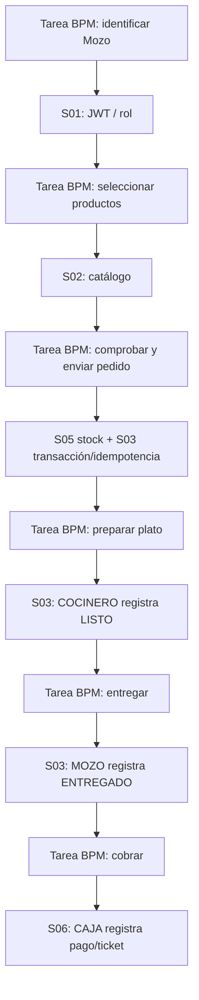

# SOA APF3 — Integración empresarial, B2B y administración BPM

**Delicias Peruanas (Arequipa, Perú)** · actualización 22/11/2026.  
**Estado:** capítulos redactados para el informe, NO informe completo. Los diagramas gráficos de estas mismas secciones están en el borrador DOCX/PDF generado en la conversación.

> Alcance verificado: monolito modular Spring Boot / Java 21, REST/JSON, S01–S06, autenticación JWT+RBAC, H2 local de demostración. **No** hay microservicios desplegados independientemente, ESB, UDDI, WebSocket, integración bancaria automática ni facturación tributaria conectada. Las nuevas migraciones no se aplicaron a Aiven.

## 1. Implementación SOA: inventario de servicios (4 puntos)

| ID | Servicio / tipo | Contrato implementado (HTTP, JSON) | Entrada / salida | Reglas y seguridad |
|---|---|---|---|---|
| S01 | Identidad / transversal | `POST /api/auth/login` | correo/clave → JWT+rol | BCrypt, JWT y RBAC, 401 |
| S02 | Producto / entidad | `GET /api/productos`, CRUD protegido | producto, precio, estado → catálogo JSON | GET público, administración protegida |
| S03 | Pedido / proceso | `POST /api/v1/pedidos/envio`, GET pedidos, estados de plato | mesa/llevar, items, observaciones, `Idempotency-Key` → pedido/total | 201/200, 409, 422, validación de stock, permisos por rol |
| S04 | Reserva / entidad | `POST /api/reservas`, GET interno | fecha, mesa, personas, horario → reserva PENDIENTE | Solapamiento 409; GET global no público |
| S05 | Inventario / entidad | `GET /api/v1/inventario`, PATCH reponer/salida | producto, porciones, comentario → stock y movimiento | Bloqueo transaccional, auditoría, 403/422 |
| S06 | Caja / proceso | `POST /api/v1/ventas/pedidos/{id}/cobrar`, GET detalle-diario | pedido, método, monto/referencia → ticket y venta | roles Caja/Supervisor/Admin, evita doble cobro |

**Capas:** interfaz web → API/Controller → servicio de negocio/orquestación → repositorios JPA → H2 demo o MySQL. Spring Security/JWT opera de forma transversal; no se cuenta cada clase como microservicio independiente.

### Ejemplo de contrato real S03

```http
POST /api/v1/pedidos/envio
Authorization: Bearer <JWT>
Idempotency-Key: mesa1-lomo-sin-sal-001
Content-Type: application/json

{"tipoAtencion":"MESA","mesaId":1,"items":[{"productoId":1,"cantidad":1,"observacion":"Bajo en sal"}]}
```

Éxito `201 Created` con pedidoId/estado/total. Repetición idéntica `200 OK`. Reutilización de la clave con contenido distinto `409 Conflict`. Sin existencias `422 Unprocessable Entity`. La orden y la afectación de stock se coordinan en una transacción local.

## 2. Aplicación consumidora y tecnologías (4 puntos)

La interfaz pública y el panel de seis roles usan **REST/JSON** y JavaScript `fetch()`. El desarrollo es **code-first** en Spring Boot, documentable mediante OpenAPI. SOAP/XML sería una alternativa si un socio empresarial exigiera ese contrato; **no está implementado**. La integración usa llamadas locales sin ESB. El refresco de las vistas cada ~5 s es *polling REST*, no mensajería asíncrona ni WebSocket.

| Tecnología | Función | Justificación |
|---|---|---|
| Java 21 + Spring Boot | Contratos REST y reglas | Arquitectura por capas y testabilidad |
| HTML/CSS/JS | Consumidor de API | Panel simple y portable |
| JWT + BCrypt + Spring Security | Autenticación/autorización | RBAC validado también en backend |
| Spring Data JPA | Persistencia | Acceso transaccional a entidades |
| H2 (demo), MySQL (base del sistema) | Datos | Ensayo aislado sin tocar producción |
| MockMvc/JUnit + Postman + GitHub Actions | Pruebas | HTTP, reglas, permisos, regresión |
| OpenAPI/Swagger | Registro descriptivo de endpoints | Consulta técnica; **NO UDDI operativo** |

**UDDI** es un modelo para publicar/descubrir servicios y sus descripciones, no para almacenar las ventas ni ejecutar las llamadas. En el proyecto corresponde el catálogo/descripcion OpenAPI; un directorio UDDI no es necesario para el monolito actual. La especificación OpenAPI define descripciones legibles por personas y software [3].

## 3. Integración del proceso empresarial (4 puntos, parte 1)

### Actividades y servicios

1. Mozo inicia sesión — S01.
2. Selecciona mesa/llevar y consulta platos/precio — S02 y S03.
3. S05 comprueba disponibilidad con bloqueo; S03 registra/ confirma la comanda con clave idempotente.
4. Cocinero ve la observación y cambia PENDIENTE → LISTO — S03.
5. Mozo cambia LISTO → ENTREGADO — S03.
6. Caja liquida por efectivo/Yape/POS/transferencia y S06 deja registro/ticket; se libera mesa.
7. S04 se usa para la agenda de reservas; no debe confundirse una solicitud PENDIENTE con una reserva confirmada.

### Diagrama de orquestación de servicios



**Elección:** orquestación dentro del Spring Boot modular; el controlador y el servicio coordinan llamadas transaccionales. No se usa ESB por tamaño, baja heterogeneidad y despliegue único. Una coreografía por eventos sería una evolución, no una realidad actual. Error principal: stock insuficiente, que revierte la transacción y responde 422; idempotencia protege frente a reintentos con la misma referencia.

## 4. B2B (4 puntos, parte 2): diseño futuro, NO implementado

### Organizaciones, roles y cinco servicios

| Código | Organizaciones | Servicio potencial | Integración futura |
|---|---|---|---|
| B01 | Restaurante ↔ proveedor alimentario | Consultar disponibilidad y cotización de insumos | REST/JSON/HTTPS |
| B02 | Restaurante → proveedor alimentario | Emitir orden de compra idempotente | REST/JSON/HTTPS |
| B03 | Operador logístico ↔ restaurante | Despacho, ruta y confirmación de entrega | REST/JSON/HTTPS |
| B04 | Operador de pagos ↔ restaurante | Confirmar pagos bancarios externos | REST/JSON + firma |
| B05 | Proveedor autorizado ↔ restaurante | Intercambio para emisión electrónica de comprobante | SOAP/XML solo si su contrato lo requiere |

### Diagrama de arquitectura B2B propuesta



**Dos controles:** (1) TLS y autorización de cliente/ámbito (OAuth2 u otra credencial de máquina), (2) firmas y verificación de webhooks + idempotencia y protección ante mensajes repetidos. **Error B2B:** proveedor caído o confirmación perdida, con riesgo de orden duplicada. **Solución propuesta:** referencia única, consulta de estado antes de reintento, backoff, registro durable y conciliación manual. No afirmar que estas funcionalidades externas funcionan hoy.

## 5. Administración de procesos BPM (4 puntos)

### 5.1. Problema As-Is y actividades

El registro manual, la consulta verbal de disponibilidad y la ausencia de estados comunes pueden causar demora, pérdida de detalles y discrepancias entre Cocina, Mozo y Caja. Es un **modelo simplificado de referencia**, no tiempos reales medidos.



### 5.2. Dos mejoras y To-Be

- **M1:** consultar porciones/precio antes del envío; la reserva de S05 y la creación S03 son transaccionales.
- **M2:** notas y estados individuales, tiempos LISTO/ENTREGADO, ticket y reporte diario, con separación de deberes.



### 5.3. Indicadores KPI — metas propuestas, NO mediciones

| KPI | Fórmula | Fuente | Meta inicial hipotética |
|---|---|---|---|
| Tiempo medio de preparación por plato | Σ(fechaListo − fechaInicio)/platos terminados | Marcas de tiempo S03 | ≤ 15 min |
| Tasa de anulaciones de plato | 100 × (líneas ANULADO / total líneas creadas) | Auditoría de detalle de S03 | ≤ 5 % |

Se requiere recolectar una **línea base real** y observar el proceso antes de afirmar mejoras o porcentajes alcanzados.

### 5.4. Diagrama BPM + SOA



**BPM** define actividades, actores, decisiones y métricas; **SOA** ofrece operaciones reutilizables y controles para ejecutarlas. Los diagramas As-Is/To-Be muestran tareas, eventos y compuertas como **BPMN simplificado**; para un diagrama formal más riguroso en Bizagi conviene exportarlos con piscinas/carriles y asociaciones, ver las ilustraciones del borrador Word.

## 6. Conclusiones (2 puntos)

1. Se implementaron servicios de negocio REST que integran identidad, catálogo, pedidos, reservas, inventario y caja, permitiendo el flujo de atención real de la demo.
2. La transacción local, idempotencia y RBAC protegen la consistencia; el prototipo sigue siendo monolito modular, no una arquitectura distribuida completa.
3. El To-Be hace observables los estados por plato y la operación comercial; las mejoras de tiempo requieren mediciones reales para probarse.
4. El esquema B2B ilustra interoperabilidad con socios externos, pero no se ha programado ni probado dicha conectividad.
5. Antes de producción corresponde realizar migraciones autorizadas, asegurar persistencia, reforzar observabilidad y completar evidencias de desempeño y seguridad.

## 7. Referencias IEEE (borrador)

[1] Object Management Group, *Business Process Model and Notation 2.0.2*, 2014. https://www.omg.org/spec/BPMN/2.0.2  
[2] W3C, *SOAP Version 1.2 Part 1: Messaging Framework (Second Edition)*, 2007. https://www.w3.org/TR/soap12-part1/  
[3] OpenAPI Initiative, *OpenAPI Specification, Version 3.1.1*, 2024. https://spec.openapis.org/oas/v3.1.1.html  
[4] UTP, *AC-S15-APF3 — Arquitectura Orientada al Servicio*, enunciado del curso, 2026.  
[5] Delicias Peruanas, *Repositorio del prototipo de SOA APF3*, rama `feature/soa-apf3-operacion-restaurante`, 2026.

## 8. Lista de cierre académico

**Pendientes para presentar:** incorporar partes APF1/APF2 específicas de **SOA** (no sustituirlas por el informe de Integrador II); confirmar servicio/errores con capturas reales HTTP; introducir imágenes de diagramas en documento, carátula, índice, curso y enlace a video; completar referencias IEEE; mínimo seis páginas de contenido sin contar carátula, índice y referencias, Arial 11 interlineado sencillo, exportar PDF. Cámara encendida en sustentación según enunciado. La demo H2 volátil no constituye una prueba de Render/Aiven.
